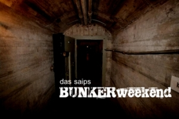
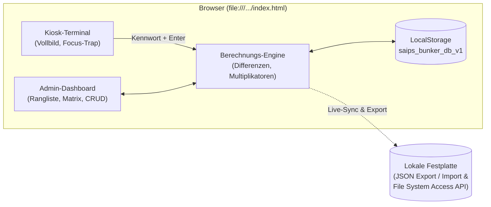

# SAIPS BunkerWeekend – Zeitschätzungs-Webapplikation



Eine lokal und offline lauffähige, serverlose Webapplikation zur Durchführung und Auswertung von Zeitschätzungs-Wettbewerben im Bunker (ohne Zeitangaben, Uhren oder externe digitale Geräte).

Die Applikation ersetzt und erweitert die historische Excel-Vorlage `Zeit_eintragen_2024_leer.xls` inklusive aller Berechnungen, Teilnehmerblätter, Ranglisten und VBA-Meldungssequenzen.

---

## Inhaltsverzeichnis
- [Highlights & Features](#highlights--features)
- [Schnellstart](#schnellstart)
  - [Unter Windows](#unter-windows)
  - [Unter Linux](#unter-linux)
  - [Manueller Start in jedem Browser](#manueller-start-in-jedem-browser)
- [Bedienung](#bedienung)
  - [Kiosk-Terminal (Teilnehmer)](#kiosk-terminal-teilnehmer)
  - [Administrationsbereich (Auswertung & Verwaltung)](#administrationsbereich-auswertung--verwaltung)
- [Architektur & Datenhaltung](#architektur--datenhaltung)
- [Kiosk- & Manipulationsschutz](#kiosk---manipulationsschutz)
- [Dateistruktur](#dateistruktur)

---

## Highlights & Features

- **100 % Serverlos & Offline:** Läuft als reine statische Web-App (HTML5, CSS3, Vanilla JS) direkt über das lokale Dateisystem (`file://`). Weder Node.js, Python noch ein lokaler Webserver oder Internetzugang sind erforderlich.
- **Null-Zeit-Garantie:** Auf der Kiosk-Oberfläche wird zu keinem Zeitpunkt eine Uhrzeit oder ein Zeitstempel gerendert.
- **Echtes Vollbild & Lockdown:** Sperrt unerwünschte Tastenkombinationen (`F1–F12`, `Tab`, `Ctrl+*`, `Alt+*`), Rechtsklick, Textauswahl und verhindert über die Screen Wake Lock API den Bildschirmschoner.
- **Exakte Excel-Berechnungslogik:**
  - Sekundengenaue Abweichung $|\text{Ist} - \text{Soll}|$
  - Früh/Spät-Indikator (`0` = Zu früh, `1` = Zu spät)
  - Multiplikator-Gewichtung (`TotalDifferenzUhrzeit`)
  - Excel-Tagesdezimalwert ($\text{Sekunden} / 86400$)
  - **Kein 24-Stunden-Überlauf:** Formatiert Dauern beliebig hoch als `HH:MM:SS` (z. B. `27:15:40`), ohne wie Excel bei 24h auf `00:00:00` zurückzuspringen.
- **Vollständige Auswertung:**
  - Podium & Gesamtrangliste (sortiert nach `Daneben inkl. Multi`)
  - Abweichungsverlauf-Diagramm (grafischer Vergleich aller Runden)
  - Differenzen-Matrix (Soll-Zeiten $\times$ Teilnehmer mit Hervorhebung der besten Schätzung)
  - Teilnehmer-Detailblätter mit manueller Korrekturmöglichkeit
- **JSON Import / Export & File System Access:**
  - 1-Klick-Export des kompletten Eventstands als `.json`
  - Importieren gespeicherter Eventstände
  - Optionale Live-Spiegelung in eine lokale JSON-Datei via Chromium File System Access API

---

## Schnellstart

### Unter Windows
Für den Einsatz auf dem Bunker-Laptop stehen zwei Starter bereit:
- **Normaler Kiosk-Modus:** Doppelklick auf `start-bunker-kiosk.bat`
  *(Startet Microsoft Edge oder Google Chrome im nativen Vollbild-Kiosk mit deaktiviertem Standby).*
- **Hardlock-Kiosk-Modus:** Doppelklick auf `start-bunker-kiosk-hardlock.bat`
  *(Beendet zusätzlich den Prozess `explorer.exe` für die Kiosk-Dauer: Taskleiste, Systemuhr unten rechts, Startmenü und Windows-Benachrichtigungen existieren auf Betriebssystemebene nicht mehr. Beim Schliessen des Browsers mit `Alt+F4` wird `explorer.exe` automatisch wiederhergestellt).*

### Unter Linux
1. Terminal im Projektordner öffnen und Skript ausführbar machen:
   ```bash
   chmod +x start-bunker-kiosk.sh scripts/start-bunker-kiosk.sh
   ```
2. Starten:
   ```bash
   ./start-bunker-kiosk.sh
   ```
   *(Schaltet Bildschirmschoner und DPMS-Standby via `xset` ab und startet Chromium, Chrome oder Firefox im nativen `--kiosk`-Modus).*

### Manueller Start in jedem Browser
Öffne einfach die Datei `index.html` per Doppelklick in einem beliebigen modernen Webbrowser (Edge, Chrome, Firefox, Brave, Safari).

---

## Bedienung

### Kiosk-Terminal (Teilnehmer)
1. Der Teilnehmer tritt an den Laptop und sieht ausschliesslich das Bunker-Banner und das Eingabefeld **Name / Kennwort**.
2. Er tippt sein persönliches Kennwort (z. B. `Reto1234` oder `Damian1572`) ein und drückt `Enter` oder klickt auf **Eintragen**.
3. Das System ordnet die Eingabe der nächsten offenen Soll-Zeit dieses Teilnehmers zu und speichert die aktuelle Uhrzeit (`new Date()`).
4. Es erscheint eine kurze Bestätigung:
   - *«1. Eintragung von Damian1572 erfolgreich»*
   - *«Damian1572, bitte setz dich an den Tisch und geh spielen!»*
5. Nach 4,5 Sekunden (oder sofort bei Druck auf `Enter`) schliesst sich das Fenster und das Feld wird für den nächsten Teilnehmer geleert und fokussiert.

### Administrationsbereich (Auswertung & Verwaltung)
- **Zugang:** Gib im Kiosk-Eingabefeld das Admin-Kennwort ein (Standard: `Admin1234`) und drücke `Enter`.
- **Reiter im Admin-Dashboard:**
  1. **🏆 Gesamtauswertung (Alle):** Podium, Rangliste, Abweichungsverlauf-Diagramm und Soll/Teilnehmer-Matrix.
  2. **📋 Teilnehmer-Details:** Detaillierte Einzelblätter aller Teilnehmer inklusive Funktion zum manuellen Nachtragen oder Korrigieren einzelner Schätzungen.
  3. **🎯 Soll-Zeiten & Multiplikator:** Hinzufügen, Bearbeiten oder Löschen von Schätzzeitpunkten (Datum, sekundengenaue Uhrzeit und Multiplikator).
  4. **🔑 Teilnehmer & Kennwörter:** Verwalten von Teilnehmern, Status (Aktiv/Reserve), Kennwort-Generator (`Name + 4 Zufallsziffern`) und Kopierfunktion für Aushänge.
  5. **⚙ JSON Import/Export & Kiosk-Schutz:**
     - JSON-Export der gesamten Datenbank
     - JSON-Import
     - **Live-Datei verknüpfen:** Automatisches Spiegeln aller Eingaben direkt auf die Festplatte
     - **Alle Schätzungen löschen:** Vorbereitung für den Start eines neuen Bunker-Wochenendes
     - **2024er Excel-Daten wiederherstellen:** Lädt den originalen Testdatensatz mit 45 Schätzungen
     - Einstellungen (Event-Titel, Admin-Kennwort ändern, Kennwort-Maskierung, Cursor-Ausblendung)
- **Zurück zum Kiosk:** Klick oben rechts auf **🔒 Zurück in Kiosk-Modus (Vollbild)**.

---

## Architektur & Datenhaltung

Die Anwendung benötigt keine Serverprozesse und keine externen Bibliotheken:



1. **Primärspeicher:** `localStorage` unter dem Schlüssel `saips_bunker_db_v1`. Alle Aktionen werden sofort und synchron auf die Festplatte geschrieben.
2. **Eingebettete Referenz:** Der vollständige 2024er Datensatz ist direkt in `app.js` eingebettet, sodass die App beim ersten Öffnen über `file://` ohne `fetch()`-Aufrufe sofort einsatzbereit ist.
3. **Chromium File System Access:** Ermöglicht das automatische Schreiben in eine verknüpfte `.json`-Datei bei jedem Tastendruck.

---

## Kiosk- & Manipulationsschutz

| Schutzmassnahme | Umsetzung |
| :--- | :--- |
| **Keine Adressleiste & Tabs** | Nativer Browser-Flag `--kiosk "file:///..." --edge-kiosk-type=fullscreen` |
| **Tastatur-Sperre** | Abfangen von `F1–F12` (Entwicklertools, Reload), `Tab`, `Escape`, `Ctrl+*`, `Alt+*` |
| **Maus-Sperre** | Deaktiviertes Kontextmenü (Rechtsklick), gesperrte Textselektion, optionaler unsichtbarer Cursor |
| **Fokus-Sicherung** | Automatischer Re-Fokus auf das Eingabefeld bei Klick oder Unfokus |
| **Display-Dauerbetrieb** | Screen Wake Lock API (`navigator.wakeLock.request('screen')`) |
| **OS-Härtung (Windows)** | Deaktivieren von Windows-Standby via `powercfg`; optionales Beenden von `explorer.exe` (entfernt Taskleiste & Systemuhr) |
| **OS-Härtung (Linux)** | Deaktivieren von DPMS und Screen Saver via `xset s off -dpms` |

---

## Dateistruktur

```text
saips-bunker/
├── index.html                      # Hauptdatei (Kiosk-Terminal & Admin-Dashboard)
├── styles.css                      # Styling (Dark-Bunker-Design, Tabellen, Kiosk)
├── app.js                          # App-Logik, Berechnungen, LocalStorage & Seed-Daten
├── README.md                       # Benutzer- und Entwicklerdokumentation (diese Datei)
├── PLAN.md                         # Fachkonzept & Anforderungskatalog
├── IMPLEMENTATION_PLAN.md          # Technischer Implementierungsplan (Blueprint)
├── Zeit_eintragen_2024_leer.xls    # Original-Excel-Vorlage
├── start-bunker-kiosk.bat          # Windows 1-Klick Kiosk-Starter
├── start-bunker-kiosk-hardlock.bat # Windows Kiosk-Starter mit explorer.exe-Abschaltung
├── start-bunker-kiosk.sh           # Linux 1-Klick Kiosk-Starter
├── assets/
│   └── bunker-bg.jpg               # Extrahiertes Original-Bunkerbild
├── data/
│   └── seed-2024.json              # Standalone JSON-Referenzdatensatz
└── scripts/
    ├── start-bunker-kiosk.ps1      # PowerShell-Startskript für Windows
    └── start-bunker-kiosk.sh       # Bash-Startskript für Linux
```
